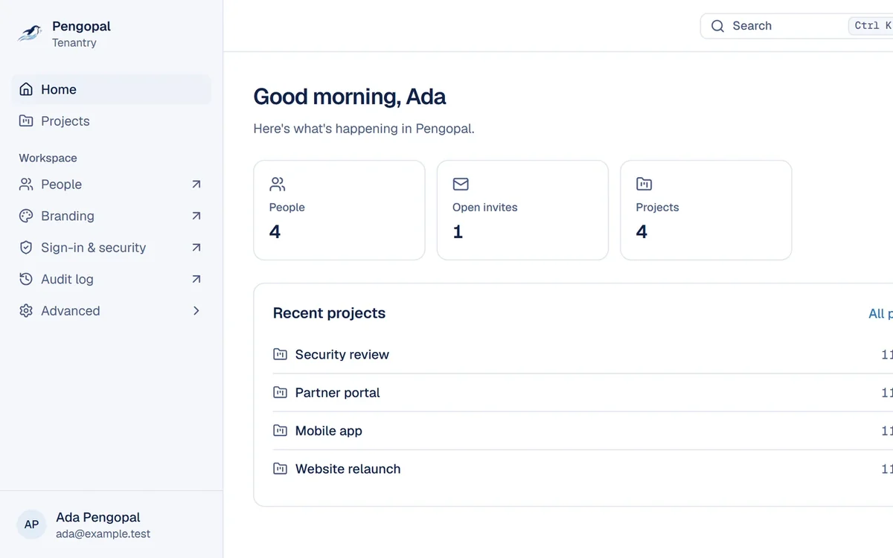
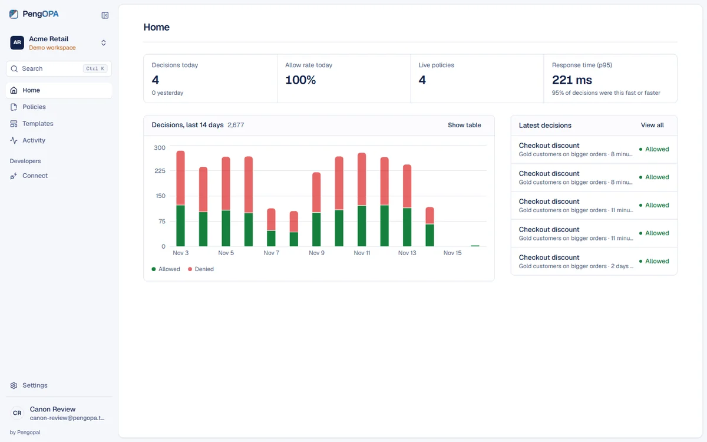
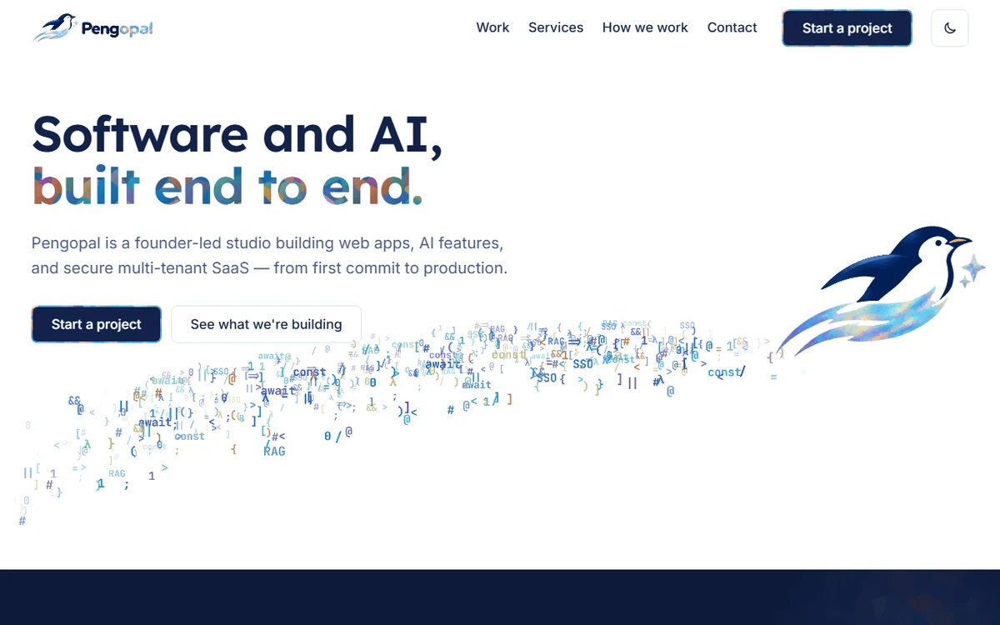
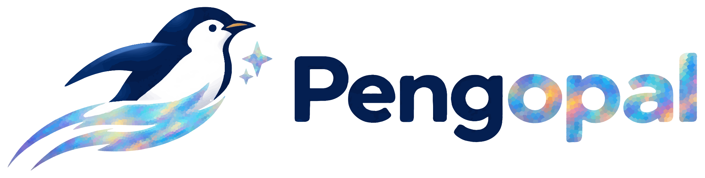

<a href="https://pengopal.com">
  <picture>
    <source media="(prefers-color-scheme: dark)" srcset="assets/banner-dark.svg">
    
  </picture>
</a>

  
  
  
  

I'm Muhammad Furqan, founder of **[Pengopal Technologies](https://pengopal.com)**. I design, build and run software end to end: multi-tenant SaaS, identity and access control, and AI features that go into real products. Everything below is open source and running live.

## What I've built

<table>
  <tr>
    <td colspan="2">
      <a href="https://tenantry.pengopal.com">
        <picture>
          <source media="(prefers-color-scheme: dark)" srcset="assets/tenantry-dark.webp">
          
        </picture>
      </a>
      <h3>Tenantry &nbsp;<a href="https://tenantry.pengopal.com">Live demo</a> · <a href="https://github.com/mfurqanwork/tenantry-keycloak-multitenancy">Code</a></h3>
      Multi-tenant sign-in, teams and branding for SaaS, built on Keycloak 26.8. Two tiers run on one codebase: standard workspaces share a realm as organizations, and each enterprise workspace gets its own realm. Isolation is enforced at the token, the API and Postgres row-level security, with 34 isolation guarantees tested in CI.
        
      
      
      
      
      
      
      
    </td>
  </tr>
  <tr>
    <td width="50%" valign="top">
      
      <h3>PengOPA &nbsp;<a href="https://opa.pengopal.com">Live demo</a> · <a href="https://github.com/Pengopal/peng-opa">Code</a></h3>
      Business rules and access policies, decided in milliseconds. A multi-tenant policy manager built on Open Policy Agent.
        
      
      
      
      
    </td>
    <td width="50%" valign="top">
      <a href="https://pengopal.com">
        <picture>
          <source media="(prefers-color-scheme: dark)" srcset="assets/pengopal-dark.webp">
          
        </picture>
      </a>
      <h3>pengopal.com &nbsp;<a href="https://pengopal.com">Live</a> · <a href="https://github.com/Pengopal/pengopal-home">Code</a></h3>
      The studio's website. The penguin's wake is a WebGL stream of code that tilts with your mouse, with a still fallback for reduced motion.
        
      
      
      
    </td>
  </tr>
</table>

**Also:** [Dolf HRMS](https://github.com/mfurqanwork/dolf-hrms) ([demo](https://dolf-hrms-ashen.vercel.app)), a multi-tenant HR system MVP for employees, attendance, requests and role-based access, in English and Arabic (right-to-left). Built with FastAPI, React and PostgreSQL.

## Toolbox

| Area | Tools |
|---|---|
| **Languages** |    |
| **Frontend** |      |
| **Backend** |     |
| **Identity & policy** |    |
| **Data & infra** |      |
| **Testing** |   |

 

<picture>
  <source media="(prefers-color-scheme: dark)" srcset="https://raw.githubusercontent.com/mfurqanwork/mfurqanwork/output/snake-dark.svg">
  
</picture>

  <a href="https://pengopal.com">
    <picture>
      <source media="(prefers-color-scheme: dark)" srcset="assets/pengopal-logo-dark.svg">
      
    </picture>
  </a>

